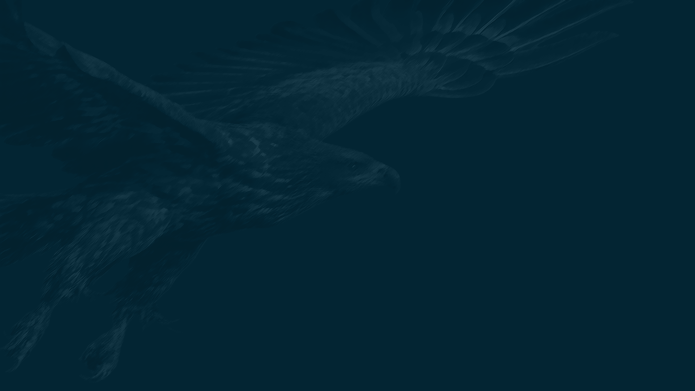

# CAH Law — Design System de Apresentações

Design System do **Carneiro & Hannemann Law** para criar apresentações com a identidade da marca: cores, tipografia, logotipos, grafismos e os sete layouts de slide do modelo oficial de PowerPoint.

Foi construído a partir de duas fontes oficiais:

- **Manual da Marca** (`Cah_Law_Manual_Da_Marca_pdf.pdf`): cores institucionais, versões do logotipo, área de proteção, redução máxima e tipografia de apoio.
- **Modelo de PowerPoint** (`Cah_Adv_PPT.pptx`): cores, tamanhos de texto, posições e imagens de cada slide.

**No Claude:** https://claude.ai/artifact/CALcs9J4rLaJmjozTgQJW5 (privado; compartilhe pelo menu *Share* da página)

---

## Estrutura

```
design-system/
├── README.md              Manual de uso: voz, cores, tipografia, layout, logotipo
├── tokens.json            Fonte única dos tokens (cores, tipos, espaçamentos, raios, layout)
├── tokens.css             Os mesmos tokens como variáveis CSS e classes de texto
├── design-system.json     Índice usado pelo Design System no Claude
├── components/
│   ├── bundle.css         Layouts de slide (classes cah-*)
│   ├── Capa/              README.md + preview.html de cada layout
│   ├── Texto/
│   ├── Frase/
│   ├── Colunas/
│   ├── Destaque/
│   ├── Encerramento/
│   ├── Marca/
│   └── Cover/             Capa visual do Design System
├── fonts/                 Arsenal Regular, Italic, Bold, Bold Italic (.ttf) + licença OFL
└── assets/
    ├── Logotipos/         Sigla, completo, versões 10 anos, símbolo e selo (SVG)
    ├── Grafismos/         Faixas douradas diagonais (SVG)
    └── Imagens/           Fotos da águia usadas como fundo (PNG)
```

## Cores

| Token | Hex | Uso |
| --- | --- | --- |
| `azul-fundo` | `#032533` | Fundo dos slides escuros |
| `dourado-claro` | `#C09C54` | Títulos sobre fundo escuro |
| `dourado-escuro` | `#9A7D44` | Títulos sobre fundo claro, faixas douradas |
| `cinza-texto` | `#E8E8E8` | Texto sobre fundo escuro |
| `cinza-claro` | `#D1D1D1` | Fundo dos slides claros |
| `azul-filete` | `#1E5B70` | Filete vertical entre título e texto |
| `azul-institucional` | `#002A3A` | Pantone 303C, referência para impressão |
| `dourado-institucional` | `#A58243` | Pantone 8384C, referência para impressão |

Há dois temas: **escuro** (padrão) e **claro**. Os tokens semânticos `fundo`, `texto`, `texto-linha-fina`, `titulo` e `filete` mudam de valor conforme o tema. A lista completa, com CMYK e notas de contraste, está em [`design-system/tokens.json`](design-system/tokens.json).

## Tipografia

Uma família só: **Arsenal**. Os tamanhos são para um canvas de 1920 × 1080; 1pt do PowerPoint equivale a 2px.

| Estilo | Tamanho | Peso | Uso |
| --- | --- | --- | --- |
| `titulo-frase` | 48px | Negrito itálico, caixa alta | Frase de efeito |
| `titulo-secao` | 40px | Negrito itálico | Títulos de slide |
| `destaque` | 32px | Negrito itálico | Chamada acima do texto |
| `linha-fina` | 32px | Itálico | Linha fina sob o título |
| `corpo` | 28px | Regular | Texto corrido e contato |
| `rotulo` | 36px | Negrito | Rótulos do slide Marca |
| `rodape` | 24px | Regular | Rodapé |

## Layouts de slide

| Layout | Slide do PPT | Uso | Tema |
| --- | --- | --- | --- |
| `Capa` | 1 e 2 | Abertura com sigla ou logotipo completo e selo 10 anos | escuro |
| `Texto` | 3 | Título e um parágrafo à direita, sobre a águia | escuro |
| `Frase` | 4 | Uma frase de efeito em caixa alta | escuro |
| `Colunas` | 5 e 6 | Título e linha fina, filete, texto corrido | escuro ou claro |
| `Destaque` | 7 | Título, filete, chamada e texto | escuro |
| `Encerramento` | 8 | Logotipo completo e contato | escuro |
| `Marca` | 9 | Catálogo de logotipos e fonte (uso interno) | cinza |

Cada pasta em `design-system/components/` tem um `README.md` com a marcação HTML do layout e o que você precisa fornecer, além de um `preview.html` que abre direto no navegador.

## Como usar

### No Claude

Abra o link do Design System acima e escolha-o como design system ao pedir uma apresentação. O Claude lê o `README.md` e os tokens e monta os slides com os layouts daqui.

### Em HTML

```html
<link rel="stylesheet" href="design-system/tokens.css">
<link rel="stylesheet" href="design-system/components/bundle.css">

<section class="cah-slide cah-frase" data-theme="escuro">
  
  
  <h2 class="cah-frase__texto cah-titulo titulo-frase">Visão de longo alcance, execução precisa</h2>
  
</section>
```

Cada slide mede 1920 × 1080. Para caber na tela, escale o `<section>` com `transform: scale()`.

### No PowerPoint

Use os valores divididos por dois: títulos em 20pt, texto em 14pt, frase de efeito em 24pt, sempre em Arsenal. As cores e os logotipos são os mesmos.

## Regras essenciais

- Use sempre os arquivos de `assets/Logotipos/`. Não redesenhe, recolora, distorça nem aplique sombra no logotipo.
- Use a versão **negativa** sobre o azul e a **positiva** sobre fundos claros.
- Títulos sempre em negrito itálico. Texto em parágrafos, sem marcadores e sem emoji.
- Cantos retos, sem sombras, sem degradês. A única textura é a foto da águia.

O manual completo de uso está em [`design-system/README.md`](design-system/README.md).

## Licenças

- **Arsenal** é distribuída sob a SIL Open Font License 1.1 ([`design-system/fonts/OFL.txt`](design-system/fonts/OFL.txt)).
- **Logotipos, grafismos e imagens** são propriedade do Carneiro & Hannemann Law. Não estão sob licença aberta, então mantenha este repositório **privado** no GitHub.
